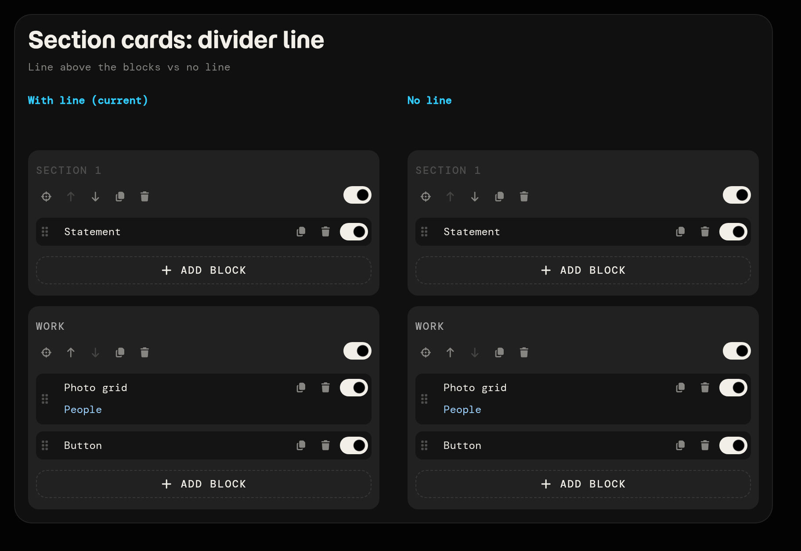
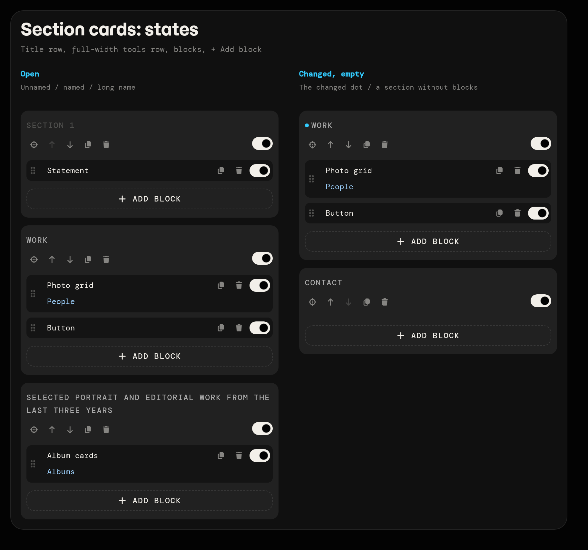
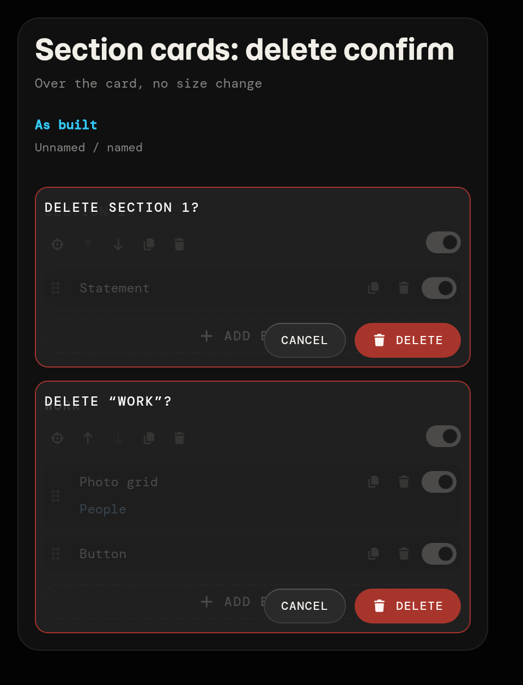
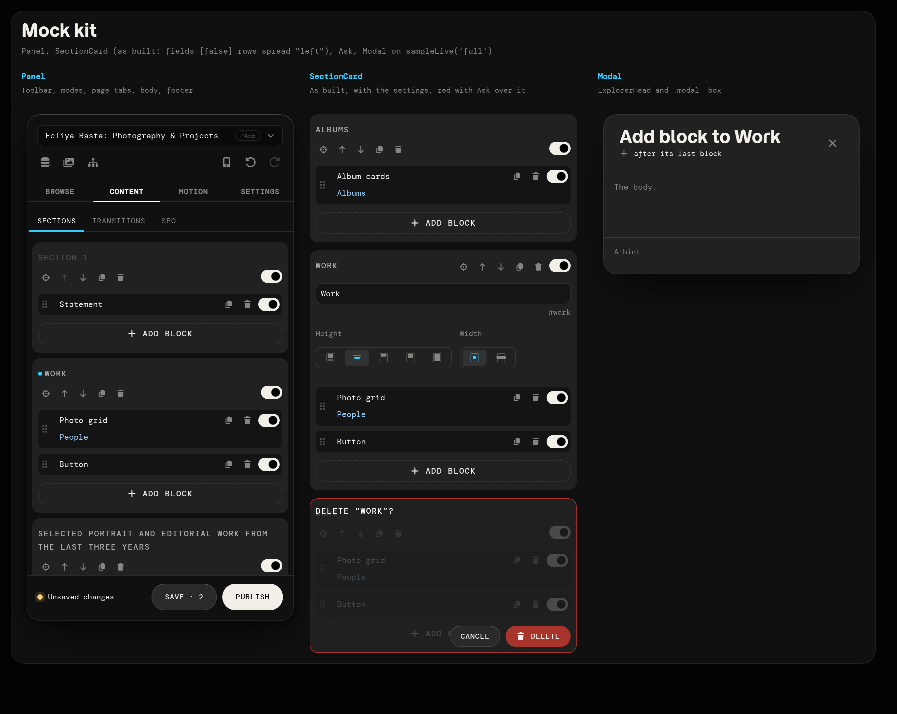

# Mockup protocol (for any agent or bot)

Read this once, then make mocks right away. Everything you need is here: rules, where files go,
how to push them, the kit's every prop, a copy-paste template and reference screenshots.

## 1. What a mockup is

- **"mup"** in a request = mockup only. A mock is a throwaway `.svelte` page in the sandbox that
  shows 2+ design options side by side. **Never build it in the app** (`src/`) until Eeliya
  approves a variant. ("jex" = explain only, build nothing.)
- Mocks are **local only**: `sandbox/mocks/<name>.svelte` is git-ignored. Never commit, push or
  copy them into the repo's history. (The kit, viewer, scripts and this doc are tracked.)
- Make them **on the PC Eeliya is using**, not on your own machine:
  - Home PC (Windows): repo at `S:\eeliyarasta-website` → `S:\eeliyarasta-website\sandbox\mocks\`
  - Work PC (WSL): repo at `~/work/eeliyarasta-website` inside WSL (commands start in Windows
    PowerShell) → `~/work/eeliyarasta-website/sandbox/mocks/`
- Don't touch Eeliya's uncommitted work on those PCs (e.g. untracked `content/pages/`).

## 2. Push in one command

Pack the mock files as a base64 tar.gz on your side:

    tar czf - section-cards-a.svelte section-cards-b.svelte | base64 -w0

**Work PC (WSL)** (from PowerShell; `sandbox/mock-push.sh` writes, checks the server, prints timings):

```powershell
wsl.exe bash -lc 'cd ~/work/eeliyarasta-website && echo <b64> | bash sandbox/mock-push.sh'
wsl.exe bash -lc 'cd ~/work/eeliyarasta-website && echo <b64> | bash sandbox/mock-push.sh --rm old-a,old-b'
```

Why base64: PowerShell rewrites `$…` and strips double quotes inside the command before WSL sees
it. Base64 has neither, so the payload arrives intact; wrap the command in **single** quotes and
put no `$` or `"` in it. Plain commands go as they are, e.g.
`wsl.exe bash -lc 'curl -s localhost:5199/__mocks/list'`.

**Windows PC** (plain PowerShell, no bash): write each file from its own base64 (no quoting
problems either), one command for all files:

```powershell
$d='S:\eeliyarasta-website\sandbox\mocks'; [IO.File]::WriteAllBytes("$d\section-cards-a.svelte",[Convert]::FromBase64String('<b64 of the file>')); Remove-Item "$d\old-a.svelte" -ErrorAction SilentlyContinue; (Invoke-WebRequest -UseBasicParsing http://localhost:5199/__mocks/list).Content
```

Output of `mock-push.sh`: `wrote: …`, `deleted: …`, `server: all listed` (or `missing …` / `not
running`), `delete=…ms write=…ms check=…ms`. Overwriting a same-named mock is fine; `--rm` is
optional (only when asked to redo or clear mocks).

## 3. View and screenshot

    npm run mock:serve          # Vite on port 5199 (MOCK_PORT), HMR; new mocks appear by themselves

- List: `http://localhost:5199/edit/sandbox/` · one mock: `…/?mock=<name>` · stacked:
  `?mock=a,b` · panel width `&width=N` · no panel `&bare=1` · `/__mocks/list` (JSON).
- Send Eeliya the links: `http://localhost:5199/edit/sandbox/?mock=<name>`.
- Screenshot (headless Chrome, 2x): `MOCK_PORT=5199 npm run mock -- <name> [--bare] [--width N]
[--out file.png]` → `$MOCK_DIR/<name>.png` (default `../mocks/` next to the checkout).
  Chrome: `CHROME`, else the usual install path (`/usr/bin/google-chrome` on Linux).

## 4. Template (copy, rename, change the variants)

```svelte
<!-- mock: section cards: line above the blocks vs none -->
<script>
  import { Compare, Variant, SectionCard, sampleLive } from '../kit/index.js';
  const live = sampleLive('short');
</script>

<Compare title="Section cards: divider line" note="Line above the blocks vs no line" cols={2}>
  <Variant label="With line (current)">
    <SectionCard {live} at={0} fields={false} rows spread="left" />
    <SectionCard {live} at={1} fields={false} rows spread="left" />
  </Variant>
  <Variant label="No line">
    <SectionCard {live} at={0} fields={false} rows spread="left" line={false} />
    <SectionCard {live} at={1} fields={false} rows spread="left" line={false} />
  </Variant>
</Compare>
```



## 5. Kit cheat sheet

Import everything from `'../kit/index.js'` (from a mock). Real editor components, if you need
one the kit lacks: `'../../src/editor/svelte/<Name>.svelte'` (Button, Section, Field, Select,
Tabs, ExplorerHead, …). `{live}` is required wherever listed.

**Compare** — the mock's frame: title, note, a grid of variants.

| prop    | type       | default          | meaning                                                                  |
| ------- | ---------- | ---------------- | ------------------------------------------------------------------------ |
| `title` | string     | `''`             | one-line title                                                           |
| `note`  | string     | `''`             | a line under it                                                          |
| `cols`  | number     | `3`              | columns                                                                  |
| `width` | CSS length | `var(--panel-w)` | each column's width (a container: the editor's container queries see it) |

**Variant** — one labelled cell (label in accent, note muted, children stacked 12px apart).

| prop    | type   | default | meaning                                                        |
| ------- | ------ | ------- | -------------------------------------------------------------- |
| `label` | string | `''`    | e.g. `"Left (current)"`, `"A"`                                 |
| `note`  | string | `''`    | what it is, 1–2 lines (its 32px space is kept even when empty) |

**SectionCard** — a page section's card (real `Section` + `SectionSettings`, its blocks, + Add block).

| prop       | type                     | default  | meaning                                                                                                             |
| ---------- | ------------------------ | -------- | ------------------------------------------------------------------------------------------------------------------- |
| `live`     | sampleLive()             | required | the page state (one per mock, shared by the cards)                                                                  |
| `at`       | number                   | `0`      | the section's index in that page                                                                                    |
| `fields`   | bool                     | `true`   | `false`: no settings body (**the list as built**)                                                                   |
| `rows`     | bool                     | `false`  | title on its own row (wraps), tools on a second row (the real Section's `stack`)                                    |
| `spread`   | `''`\|`'left'`\|`'even'` | `''`     | with `rows`: `even` spreads the tools evenly; `''` / `left`: from the left edge, switch at the right (**as built**) |
| `line`     | bool                     | `true`   | `false`: no line above the blocks (space kept)                                                                      |
| `changed`  | bool                     | `false`  | the 6px accent dot before the title                                                                                 |
| `red`      | bool                     | `false`  | border red (no size change) — use with a delete confirm                                                             |
| `height`   | CSS length               | `''`     | fix the card's height, content clipped                                                                              |
| `tools`    | snippet                  | —        | replaces the bar's tools (Show, ↑, ↓, Duplicate, Delete, switch)                                                    |
| `over`     | snippet                  | —        | drawn over the card at its exact box; give the root `class="kit-over"` (whole card) + `kit-over--bar` (header only) |
| `children` | snippet                  | —        | replaces the settings body                                                                                          |

Always open, as built (dae1ba8): the real Section's `onenter`, so no caret and no open/closed;
the title is a button (pointer) that opens the section in the app (in a mock it does nothing).
In the kit its hover keeps the title's brightness (the app's white title hover is left out).
Title: the section's `name`, else "Section N" dimmed. The switch reflects `enabled !== false`;
↑/↓ disable at the first/last section.

**Ask** — the section delete confirm as built, for `over` (add `red` to the card).

| prop       | type   | default                  | meaning             |
| ---------- | ------ | ------------------------ | ------------------- |
| `question` | string | `'Delete this section?'` | the line at the top |

**BlockCard** — one block row (grip, name, Duplicate, Delete, switch, its title under). Inside a `<ul class="blocks">` in a `kit-list` scope (SectionCard does this).

| prop    | type                       | default  | meaning                                 |
| ------- | -------------------------- | -------- | --------------------------------------- |
| `block` | `{id,type,title?,config?}` | required | `config.enabled === false` = switch off |
| `tools` | snippet                    | —        | replaces Duplicate / Delete / switch    |

**Panel** — the editor's side panel around your cards.

| prop       | type                                           | default                     | meaning                                             |
| ---------- | ---------------------------------------------- | --------------------------- | --------------------------------------------------- |
| `mode`     | `'browse'`\|`'text'`\|`'motion'`\|`'settings'` | `'text'`                    | active mode tab (`text` = "Content")                |
| `tab`      | `'sections'`\|`'transitions'`\|`'seo'`         | `'sections'`                | page tab (only in `text`)                           |
| `tabs`     | bool                                           | `true`                      | `false` hides the page tabs                         |
| `height`   | CSS length                                     | `'844px'`                   | panel height (body scrolls)                         |
| `changes`  | number                                         | `0`                         | unsaved count: "Unsaved changes", Save · N, Undo on |
| `pending`  | string                                         | `'Everything is published'` | footer line when no changes                         |
| `children` | snippet                                        | —                           | the scroll body                                     |

**Modal** — a modal shell drawn in place (`.modal__box` + real ExplorerHead).

| prop               | type        | default                | meaning                          |
| ------------------ | ----------- | ---------------------- | -------------------------------- |
| `title`            | string      | required               | header title                     |
| `icon`             | `'fa-…'`    | `'fa-window-maximize'` | header icon                      |
| `crumbs`           | `[{label}]` | `[]`                   | header crumbs                    |
| `width` / `height` | CSS length  | `'720px'` / `'480px'`  | box size                         |
| `children`         | snippet     | —                      | body (16px padding, scrolls)     |
| `foot`             | snippet     | —                      | footer row (56px, space-between) |

**Sample data** (`sample.js`)

- `sampleLive(name | sections?)` → a fresh live editor state. `sampleLive()` = `SECTIONS`;
  `sampleLive('short' | 'full' | 'states')` = a `samplePage`; `sampleLive([...])` = your own.
- `samplePage.short`: 0 unnamed (intro) · 1 "Work" (grid "People", button)
- `samplePage.full`: 0 unnamed (intro) · 1 "Work" (grid, button) · 2 "Albums" (albums) ·
  3 "Selected portrait and editorial work from the last three years" (projects, grid "Places") ·
  4 unnamed (projects, button)
- `samplePage.states`: 0 "Work" (grid, button) · 1 "Contact" switched off (button) · 2 unnamed, no blocks
- `SECTIONS`: the six-section home page · `PAGES`: the page menu items · `FILE`: `'pages/index.json'`
- `block(id, type, title?)` builds a block; `labelOf(block)` its editor name. Block types:
  `hero`, `intro` ("Statement"), `grid` ("Photo grid"), `button`, `albums`, `projects` ("Project list"), …
  (`src/site/blocks/index.js`).

Own data: `sampleLive([{ id: 's-1', name: 'Work', enabled: false, blocks: [block('b-1', 'grid', 'People')] }])`.

## 6. Design rules

- Real editor styles and icons only (they load inside a mock): tokens like `var(--space-2)`,
  `var(--c-card)`, `var(--c-accent)`, Font Awesome `fa-solid fa-…`, the real `Button`. No new look.
- Controls 32px (bar buttons `size="small"`), everything on a 4px grid (`--space-1` = 4px).
- At most 5 classes per element, so the markup never looks like Tailwind (no long utility-class chains; style in SCSS instead); accent **#33ccff** (`--c-accent`).
- Repeated declaration groups are SCSS mixins, not classes (`src/editor/styles/_mixins.scss`:
  `row`, `stack`, `muted`, `ellipsis`, `focus-ring`; `@use '../styles/mixins' as *;` in a
  `<style lang="scss">`). Only those five: don't add more for a mock.
- **No layout shifts, ever**: hints, markers, dots, red borders and confirms must not push or
  resize anything (overlay them, reserve their space, or use a border that already exists).
- Each mock compares **2+ variants side by side**; the current version is labelled **"(current)"**.
- Name: `<area>-<topic>.svelte` (e.g. `section-cards-noline`); first line a one-line
  `<!-- mock: what it compares -->` comment.
- Show realistic cases: unnamed, short and very long names, changed, empty (the sample pages have them).

### The current section card (decided, built in f214d8a)

`<SectionCard {live} at={i} fields={false} rows spread="left" />`

- No settings fields in the list's cards; title on row 1, tools on row 2 (Show, ↑, ↓,
  Duplicate, Delete from the left, the switch at the right); a line above the blocks.
- Always open (dae1ba8): no caret; a click on the title (pointer, white on hover) opens the
  section: its first block's view, or an empty section's own view. Hovered, the card's border
  turns soft white (70%) and its section is outlined in the preview (be67424).
- Changed: a 6px `#33ccff` dot before the title, no shift.
- Delete confirm (`red` + `Ask` in `over`): over the card at its size, the card's colour at 80%
  dims it, red border, the question at the top (no background of its own), Cancel / Delete
  (trash icon) at the bottom right, 8px padding.





## 7. Speed

- Don't look anything up: this sheet has every prop. Write the whole mock in one go from the template.
- Use a `samplePage` instead of writing sample data.
- One push command per round (pack all files, `--rm` in the same call), no separate checks:
  `mock-push.sh` already confirms the server lists them.
- Reply with the viewer links and one line per variant.
